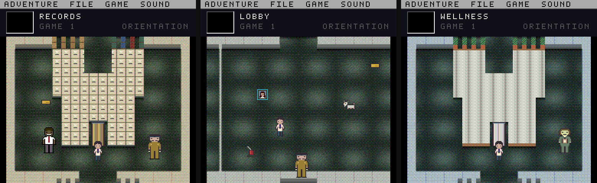
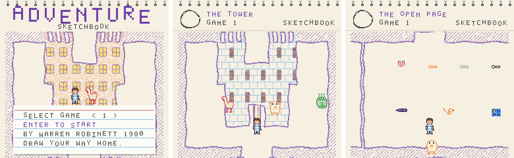

# Shall we play a game?

Demo packs for [Adventure Forever](https://github.com/majonesmax/adventure-forever) - Atari 2600 *Adventure*
running unmodified in an emulator and redrawn live from its RAM. Each demo is a **pack**: a cast (who's in
the game) and a world (where it happens) that any of Adventure Forever's looks can show.

| Demo | |
|---|---|
| **[ORIENTATION](packs/orientation)**<br>best in the VGA look | an office floor that goes on too long: off-white corridors, dim green carpet, flickering fluorescent light, departments behind elevator doors, a goat, and its own FM soundtrack<br><br>▶️ **[Watch it played through on YouTube](https://youtu.be/t0TFnZ-mORw)** (1:44)<br><br><a href="packs/orientation"></a> |
| **[SKETCHBOOK](packs/sketchbook)**<br>best in the paper look | a blank page, and only what a boy in striped pyjamas has drawn on it in purple crayon: wobbly walls, his house with the lights on, the things he drew that got out of hand, a moon to bring home, and a music-box soundtrack<br><br><a href="packs/sketchbook"></a> |

## Playing a demo

**With the app** ([download Adventure Forever](https://github.com/majonesmax/adventure-forever#%EF%B8%8F-download), version 1.1 or later):

1. Download this repository: **Code → Download ZIP** at the top of this page.
2. Start Adventure Forever, and **drag the downloaded zip onto the game window** (or the unzipped folder).
   Every demo in it is added, and the first one starts. They stay added for next time.
3. Press **L** to change the look - *ORIENTATION* is made for VGA, *SKETCHBOOK* for paper (Adventure Forever
   1.2 or later) - **C** / **W** to change cast and world, **H** for every key.

The demos include a little code (each `world/world.py` paints its world's rooms) - it only draws pictures.

**From source** - with [Adventure Forever](https://github.com/majonesmax/adventure-forever#running-it-from-source-macos-windows-linux)
set up, point it at this repository's `packs` folder:

```sh
ADVENTURE_PACKS=../shall-we-play-a-game/packs python play.py --pack orientation --look vga
ADVENTURE_PACKS=../shall-we-play-a-game/packs python play.py --pack sketchbook --look paper
```

(Windows PowerShell: `$env:ADVENTURE_PACKS="..\shall-we-play-a-game\packs"; python play.py --pack orientation --look vga`.)

## Making one

Each demo here was made with an AI coding assistant (Claude Code): described in a few sentences, drawn as text
art, previewed in every look, and changed until it looked right. Do the same: clone this repository next to
Adventure Forever, open an assistant in it, and describe your idea. [CLAUDE.md](CLAUDE.md) gives it the
commands and the rules - above all, *if you know, you know*: inspired by something, naming none of it.

A pack is a folder with a `pack.json`, a `cast/` and/or a `world/`: see
[making a pack](https://github.com/majonesmax/adventure-forever/blob/main/docs/making-a-pack.md).

Code: MIT (`LICENSE`). Art: CC BY 4.0 (`LICENSE-ASSETS.md`). Adventure is © 1980 Atari, created by Warren
Robinett; not included - bring your own ROM. Fan-made demos, not affiliated with or endorsed by anyone.
